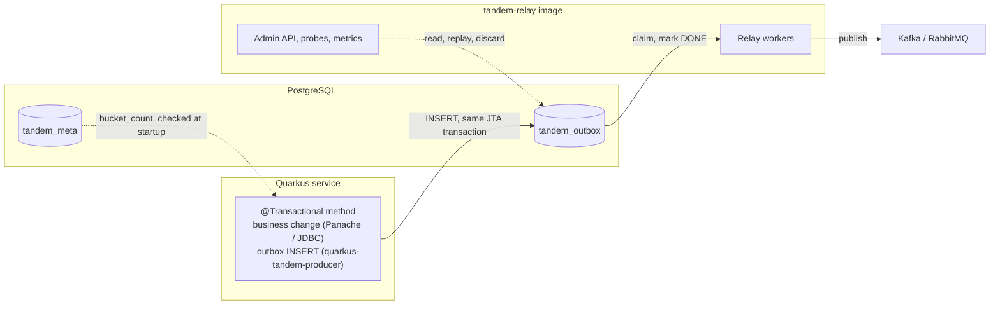

# Tandem: Quarkus Extension

**Version:** 0.1  
**Status:** Accepted. Designed, not implemented.  
**Companion to:** [HLD.md](HLD.md) §1.1, §1.3, §1.4, §3.1, §3.2, §4.2;
[LLD-spring-producer.md](LLD-spring-producer.md); [LLD-spring-config.md](LLD-spring-config.md) §2, §3;
[LLD-bucket-count-guard.md](LLD-bucket-count-guard.md); [LLD-rabbitmq.md](LLD-rabbitmq.md) §9;
[LLD-relay.md](LLD-relay.md); [HLD-managed-seq.md](HLD-managed-seq.md)

This note decides how a Quarkus application writes to the Tandem outbox: what the extension contains,
how each write-side tier of the Spring modules translates to CDI and JTA, where the extension lives
and how it is versioned, which Quarkus lines it supports, and what is left to later phases.

---

## 1. Summary

- Quarkus applications get a **Quarkus extension** (a runtime module plus a deployment module), the
  form Quarkus users discover through code.quarkus.io and its extension catalog. A plain library would
  work at runtime, but it would not appear there and could not do the build-time work of §5.4.
- **The first release is write-side only** (`quarkus-tandem-producer`). The relay and the Admin API
  already run outside the application as the `tandem-relay` image (HLD §3.2), against the same
  database: a Quarkus service writes in process and deploys the image beside it. No new runtime
  component is needed for a Quarkus service to use Tandem end to end.
- The four write-side tiers of the Spring modules carry over: plain repository, template, an
  annotation, and domain events. They map onto **Agroal** (the connection pool), **Narayana** (the JTA
  transaction manager) and **ArC** (the CDI container). The event tier gains a guarantee the Spring
  one cannot give: mapper conflicts fail the **build** (§5.4).
- The extension lives on **Quarkiverse**, the Quarkus community hub, as `io.quarkiverse.tandem`, built
  with Maven, **versioned independently** of the library and depending on it through a declared
  **floor** (§7).
- **`main` targets Quarkus 4.** A branch for the 3.40 LTS line opens only on demand (§8).
- Later phases: an embedded relay (§9.1), then the Admin API on Quarkus REST (§9.2). Out of scope: the
  reactive stack, which does not use JDBC (§10).

---

## 2. Goals and non-goals

**Goals.**

- A Quarkus service gets the same guarantees as a Spring one: the event commits or rolls back with
  the business change, events of one aggregate are published in write order, and the row it writes is
  indistinguishable to the relay from a row written by any other Tandem writer.
- **Idiomatic for Quarkus.** Configuration through `application.properties`, beans through CDI,
  transactions through `@Transactional`, works in native mode, works with Dev Services.
- **One configuration contract.** The keys are the `tandem.*` keys the Spring modules and the relay
  image already read (LLD-spring-config §2), with the same meaning and defaults.
- The client footprint rule of HLD §1.3 holds: the write-side extension never brings the Kafka client,
  the CloudEvents SDK, or a JSON binding the application did not already choose.

**Non-goals.**

- Any change to the schema, the relay, the published message or the library's public API. The
  extension is built on the published `tandem-core` and `tandem-jdbc` artifacts as they are.
- A write side on the reactive stack (Hibernate Reactive, the Vert.x SQL clients). §10 says why.
- MySQL, until the library's engine port exists (HLD §10, DB compatibility): the extension supports
  exactly the databases `tandem-jdbc` supports.

---

## 3. Topology



The database is the only coordination point, as it already is for a Spring write side with a
standalone relay. The extension never talks to the relay, the broker or the Admin API.

---

## 4. Modules

| Artifact | Contents | Depends on |
|---|---|---|
| `quarkus-tandem-producer` | Runtime: the beans, the interceptor, the configuration mapping | `tandem-jdbc`, `quarkus-agroal`, `quarkus-narayana-jta`, `quarkus-arc` |
| `quarkus-tandem-producer-deployment` | Build steps: bean registration, the event observers, native registration, startup wiring | the runtime module, the matching Quarkus deployment modules |
| `quarkus-tandem-relay` (+ `-deployment`) | Phase 2 (§9.1) | `tandem-kafka`, `quarkus-kafka-client` |

**Split by role, as the Spring modules are** (LLD-spring-config §1): a service that only writes
cannot acquire the Kafka client transitively, because the producer extension does not depend on it.
The invariant is structural, not a matter of a conditional staying correct.

**Optional integrations are detected, never forced.** OpenTelemetry tracing and the Jackson payload
serializer (§5.5, §5.6) activate when the application already has the matching Quarkus extension. The
deployment module checks the application's capabilities at build time and registers the extra beans
only then; the runtime module declares those libraries as optional dependencies.

---

## 5. The write side

### 5.1 How the transaction is joined

In Quarkus, `@Transactional` is a CDI interceptor that Narayana provides, and every Agroal datasource
takes part in JTA transactions by default (`quarkus.datasource.jdbc.transactions=enabled`). Inside an
active transaction, Agroal hands out the connection already associated with it, so Hibernate ORM and
the outbox insert run on the same connection and commit together.

The extension therefore wires `JdbcOutboxRepository` straight onto the application's Agroal
`DataSource`. Nothing plays the role that `TransactionAwareDataSourceProxy` plays in Spring
(LLD-spring-config §4.3), because joining the transaction is the pool's own behaviour here.

**The guard is simpler than Spring's, and it runs on every insert path.** Before each insert, every
tier checks that `TransactionManager.getStatus()` is `STATUS_ACTIVE` and fails with
`OutboxInsertException` otherwise. The Spring `TransactionBindingGuard` (LLD-spring-producer §8) also
checks that the transaction is bound to Tandem's own `DataSource`. That second check has no Quarkus
equivalent to perform: a JTA transaction covers every datasource used inside it. Two non-XA
datasources in one transaction are refused by Narayana at enlistment, which is loud. At startup the
extension also refuses a Tandem datasource configured with `transactions=disabled`: there the insert
would autocommit, which is the silent failure the guard exists to prevent.

**Which datasource.** The default datasource, or a named one selected by
`tandem.outbox.datasource`. That key is specific to this extension, because a Quarkus application
names its datasources in configuration rather than through bean qualifiers.

### 5.2 Startup

On `StartupEvent` the extension runs `BucketCountGuard.check` against the datasource before any bean
can insert, exactly as the Spring producer does before exposing its repository (LLD-spring-config
§3). A mismatch stops the application, loudly.

### 5.3 The four tiers

| Tier | Spring module | Quarkus extension |
|---|---|---|
| Plain | inject `OutboxRepository`, call `insert` in `@Transactional` | the same: `OutboxRepository` is a CDI bean |
| Template | `TransactionalOutboxTemplate` on Spring's `TransactionTemplate` | the same interfaces (`TransactionalOutboxTemplate`, `OutboxCollector`), on `QuarkusTransaction.joiningExisting()` |
| Annotation | `@TransactionalOutbox`, composed with `@Transactional`, AOP aspect | `@TransactionalOutbox`, an interceptor binding that carries `@Transactional`, CDI interceptor |
| Events | `ApplicationEventPublisher` + synchronous listener | `Event<T>.fire()` + synchronous observers generated at build time (§5.4) |

The extension defines its own types in `io.quarkiverse.tandem.producer`, mirroring the Spring
module's signatures (LLD-spring-producer §3, §4, §5). It does not depend on `tandem-spring-producer`,
which is built against Spring. The core types they rely on (`OutboxMessage`, `TandemAggregate`,
`PayloadSerializer`) come from `tandem-core` unchanged.

**Template.** `execute(work)` joins the caller's transaction or starts one, which is the meaning of
Spring's `REQUIRED`. It runs the work, inserts what was collected, in collection order, in that same
transaction, and lets it commit. A failure in the work or in the insert rolls everything back.

**Annotation.** CDI has no equivalent of Spring's `@AliasFor`, so `@TransactionalOutbox` cannot
expose `@Transactional`'s attributes. It carries `@Transactional` with its defaults, so a transaction
is always present and the user never writes both annotations. A method that needs another
transaction type or rollback rule uses the template inside its own `@Transactional`. The interceptor
must run **inside** Narayana's: Narayana's transaction interceptors have priority
`PLATFORM_BEFORE + 200`, and Tandem's has a higher value, so it runs closer to the method. It then
extracts and inserts exactly as the Spring aspect does: a returned `TandemAggregate` or an `Iterable`
of them, nothing for any other result, each message instance written once per transaction, and the
`aggregateType` guard. The active-transaction check of §5.1 is the backstop that makes a wrong
priority loud.

### 5.4 The event tier: observers generated at build time

The application fires ordinary CDI events inside its own transaction:

```java
@Inject Event<OrderPlaced> orderPlaced;

@Transactional
public void place(OrderId id) {
    Order o = orders.findById(id);
    o.place();
    orderPlaced.fire(new OrderPlaced(o));     // synchronous: same thread, same transaction
}
```

and registers an `OutboxEventMapper<OrderPlaced>` bean that turns the event into outbox messages, as
in LLD-spring-producer §5.

**Registering a mapper is the opt-in, and the build does the wiring.** The deployment module reads
the application's index at build time, finds every bean implementing `OutboxEventMapper<T>`, resolves
`T`, and registers one **synthetic observer** per mapped type, plus one for `OutboxMessage` fired
directly. Each observer is synchronous and runs in the firing thread during the transaction
(`TransactionPhase.IN_PROGRESS`, the CDI default), so the insert is atomic with the business change.

This gives two things the Spring tier cannot:

- **Conflicts fail the build.** Two mappers for the same `T` stop the build with an error naming both
  beans, before anything is deployed. Spring can only detect them at startup.
- **No catch-all observer.** Only the mapped types are observed. Other events, framework events
  included, never reach Tandem, without a runtime filter deciding it on every event.

**Most specific mapper wins, and only once.** CDI notifies an observer of type `A` for any event
assignable to `A`, so an event of a subtype of two mapped types reaches two observers. Each observer
therefore delegates to the same mapper registry used by the Spring tier (most specific registered
supertype; equally specific candidates are ambiguous and fail on that event), and acts only when its
own type is the one the registry selects. One event produces one mapping.

**What is not captured.** Events fired with `fireAsync()` run outside the caller's transaction, so no
synchronous observer receives them and the tier ignores them by construction. That matches the Spring
tier's refusal of `AFTER_COMMIT` listeners (LLD-spring-producer §1): an insert outside the business
transaction is not atomic.

### 5.5 Payload serialization

The rule of LLD-spring-producer §2 holds: object payloads need a `PayloadSerializer`, `byte[]` and a
pre-built `OutboxMessage` always work, and a missing serializer fails at the call site, never by
guessing. When the application has `quarkus-jackson`, the extension registers a `PayloadSerializer`
on the application's own `ObjectMapper`, so the application's Jackson configuration applies to outbox
payloads too. An application bean of type `PayloadSerializer` replaces it.

Each branch of the extension targets one Quarkus line (§8), so it targets one Jackson generation: the
branch on Quarkus 4 uses Jackson 3. The dual-generation constraint the Spring modules carry
(LLD-spring-config §1.3) does not arise here.

### 5.6 Tracing

With `tandem.tracing.enabled=true` and `quarkus-opentelemetry` present, the producer's
`TracePropagator` is `OtelTracePropagator` from `tandem-tracing-otel`, which captures the active span's
`traceparent` at insert time (HLD-tracing). As in Spring, the flag is explicit: a tracing extension
being on the classpath does not turn it on by itself.

### 5.7 The `seq` invariant

Unchanged, and the same hazard applies: Hibernate ORM advances `@Version` at flush, so a version read
before the flush is the previous one (LLD-spring-producer §7, HLD-managed-seq §3.2). Quarkus uses
Hibernate ORM, so the measurements and the two remedies (flush before building the message, or a
`seq` mode that does not depend on the version) apply as written, and the extension's guide repeats
them.

---

## 6. Configuration

The extension reads the same keys as the Spring modules, with the same meaning and defaults
(LLD-spring-config §2): `tandem.outbox.bucket-count`, `tandem.outbox.wakeup`, `tandem.tracing.*`, and
in phase 2 `tandem.relay.*` and `tandem.kafka.*`. Keys are bound through a SmallRye `@ConfigMapping`
at runtime, so a container can change them without a rebuild.

**Why `tandem.*` and not `quarkus.tandem.*`.** Quarkus extensions usually prefix their keys with
`quarkus.`. Here the keys are a contract shared by every process that touches the outbox: a value
such as `bucket-count` must be identical in the writing service and in the relay image (HLD §1.4), and
the same name in both places is what makes a divergence easy to spot. Quarkus itself reads keys
outside its own prefix where a key belongs to a wider contract (`kafka.*`, `mp.messaging.*`).

**The keys are part of the extension's contract.** A key added to the library's contract is added to
the extension in its next release; a key never changes meaning between the two.

**Schema.** As with Spring, the application owns its migrations. `tandem-jdbc` ships the Liquibase
changelog on the classpath (`tandem/schema/postgres/changelog/`), which `quarkus-liquibase` can include
directly; the guide shows it, and the Flyway equivalent.

**Dev Services.** In `quarkus dev` and in tests, Quarkus starts PostgreSQL on its own. With the
migration included, a new application runs end to end with no database to install.

---

## 7. Where it lives, and versioning

**Quarkiverse.** The extension is a repository of its own in the Quarkiverse GitHub organization, as
the hub's rules require: Maven build with `quarkiverse-parent`, group `io.quarkiverse.tandem`,
documentation on docs.quarkiverse.io, releases through the hub's pipeline. That is the visibility the
extension exists for: listing on code.quarkus.io and in the extension catalog, and the Quarkus
ecosystem CI, which builds every hub extension against Quarkus snapshots and reports a regression
before a Quarkus release ships it.

**Versioned independently, with a floor**, on the model of `tandem-rabbitmq` (LLD-rabbitmq §9). The
extension's compatibility contract is the published library API it builds on, not the library's
version, and its own changes (a Quarkus upgrade, a fix in an interceptor) need no library release. It
depends on `tandem-core` and `tandem-jdbc` by published coordinate, with a **floor of 1.0.0**: it
needs nothing the 1.0.0 API does not already have, so it can ship as soon as 1.0.0 is on Maven
Central, on its own schedule. Raising the floor is a minor version of the extension, never a patch,
and its release notes state the floor. It is not in `tandem-bom`.

**What its semver governs:** its public types (§5.3), the configuration keys it reads (§6), the
floor, and the Quarkus lines it supports. The Quarkus version within a supported line, the build
steps, and the generated observers are not part of it.

**In this repository** stay the design (this document, and an LLD when the first phase starts), the
user guide page that points to the extension, and the library it depends on.

---

## 8. Quarkus lines

| Line | Status | Java | Extension |
|---|---|---|---|
| 4.x | GA expected at the end of 2026 | 21+ | `main` |
| 3.40 LTS | Supported for 12 months from its release | 17+ | a `3.x` branch, opened only on demand |

**Why one line per branch, unlike the Spring modules.** The Spring modules ship one jar for two Boot
generations because both expose the same runtime API (LLD-spring-config §1.1). A Quarkus extension
also has a deployment module, built on Quarkus's build-step API, which a major version changes. Hub
extensions follow Quarkus with `main` on the current line and a maintenance branch per older line.

**Why Quarkus 4 first.** The extension ships after Tandem 1.0.0, when Quarkus 4 is the current line,
and a new adopter starts there. Quarkus 4 requires Java 21; Tandem's Java 17 bytecode runs on it
unchanged. The 3.40 LTS branch costs a second build and a second CI line, so it waits for a user who
needs it.

---

## 9. Later phases

### 9.1 Phase 2: an embedded relay

`quarkus-tandem-relay` runs the relay inside the application, for services that prefer one deployable
to an extra container. The engine has no framework dependency, so the extension only wires it:

- **Lifecycle** on `StartupEvent` and `ShutdownEvent`, the equivalent of the Spring module's
  `SmartLifecycle` (LLD-spring-config §4.5), with draining inside Quarkus's graceful shutdown.
- **Threads.** The relay's workers are platform threads of its own (`WorkerPool`), outside the Vert.x
  event loops, so they never block an I/O thread.
- **Kafka** through `quarkus-kafka-client`, which makes the Kafka client work in native mode, with
  the `tandem.kafka.*` keys and the hardening of LLD-spring-config §2.3.
- **Health** checks on SmallRye Health, **metrics** through `quarkus-micrometer` and
  `tandem-micrometer`, **publish spans** through `quarkus-opentelemetry` and `tandem-tracing-otel`.

### 9.2 Phase 3: the Admin API

`tandem-admin` is built on Spring MVC. A Quarkus implementation serves the same OpenAPI contract
([admin-api.openapi.yaml](admin-api.openapi.yaml)) on Quarkus REST, with the same RFC 9457 problem
types, and is verified against the contract the same way (HLD-admin-api §5). Until then the Admin API
runs in the relay image, which serves it against the same database.

---

## 10. Out of scope: the reactive stack

Hibernate Reactive and the Vert.x SQL clients do not use JDBC: their transaction is a Vert.x
connection, not a JTA transaction on a JDBC connection, and `tandem-jdbc` cannot join it. A reactive
write side would be a new adapter of the `OutboxStore` port, which the architecture allows (HLD §1.2),
on a stack a minority of Tandem's target users run (HLD §1.1). It is out of scope, and the guide says
so plainly so that nobody discovers it in production.

---

## 11. Native mode

Native compilation is a first-class requirement, because it is a common reason to choose Quarkus.
The modules the producer extension brings (`tandem-core`, `tandem-jdbc`) use no reflection, no
`ServiceLoader` and no dynamic class loading, and the PostgreSQL driver is covered by
`quarkus-jdbc-postgresql`. Every insert path is tested in native mode in the extension's CI from the
first release, not added later: a test that has never run native proves nothing about it.

---

## 12. Testing

The project's rules apply (AGENTS.md §Testing): behaviour, not coverage, and no mocks.

- **Build-time behaviour** (two mappers for one type fail the build; a datasource without
  transactions is refused) is tested with Quarkus's unit-test harness for extensions, which builds an
  application and asserts on the build outcome.
- **Atomicity**: against a real PostgreSQL from Dev Services, for each tier, a business rollback also
  removes the outbox rows, and a call without a transaction fails instead of inserting.
- **Ordering and identity with the relay**: an integration test runs the published `tandem-relay`
  image against the database the extension wrote to, and checks the events arrive on the broker in
  write order.
- **Native**: the same suite runs against the native executable.

---

## 13. Rejected alternatives

- **A plain library instead of an extension.** It would run in JVM mode, but it could not generate
  the event observers or check mappers at build time, it would need manual registration for native
  mode, and it would be absent from the extension catalog, which is the reason to build this at all.
- **One extension with both roles.** It would bring the Kafka client to every service that only
  writes, which HLD §1.3 forbids.
- **A module in this repository, with this repository's build.** It keeps the conventions and gates of
  the library, but loses the hub's catalog listing, documentation site and ecosystem CI.
- **Configuration under `quarkus.tandem.*`.** Idiomatic, but it would give the same contract two names
  depending on which process reads it (§6).
- **One catch-all observer for every event.** It would receive every CDI event of the application,
  framework events included, and decide at runtime what to ignore; the generated observers make that
  decision once, at build time.
- **Reusing `tandem-spring-producer`'s types.** That module is compiled against Spring; depending on
  it would put Spring on a Quarkus application's classpath.

---

## 14. Open points

- **When to file the Quarkiverse extension proposal.** A public step; the design above is what it
  would describe.
- **A transitive `@Transactional` on `@TransactionalOutbox`.** CDI allows an interceptor binding to
  carry another; to be confirmed against Narayana's interceptors, which bind on the transaction type.
- **The PostgreSQL wakeup listener behind Agroal** (phase 2): it unwraps a `PGConnection` and holds a
  connection open for long periods, which the pool's leak detection may report.
- **Correlation id from the logging context.** The Spring module reads it from the SLF4J MDC; Quarkus
  logs through JBoss Logging, whose MDC is a different class.
- **A dev-mode migration convenience**: whether `quarkus dev` should apply the Tandem changelog by
  itself when the application has no migration tool configured.
