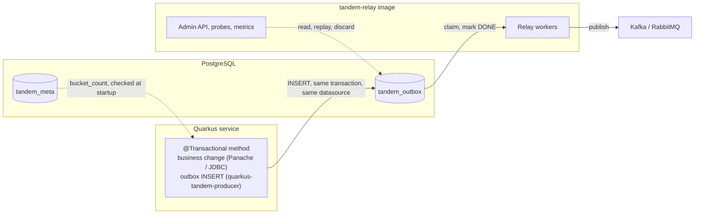

# Tandem: Quarkus Extension

**Version:** 0.4  
**Status:** Accepted. Designed and prototyped on Quarkus 3.40, not implemented.  
**Detailed in:** [LLD-quarkus.md](LLD-quarkus.md)  
**Companion to:** [HLD.md](HLD.md) §1.1, §1.3, §1.4, §3.2, §4.2;
[LLD-spring-producer.md](LLD-spring-producer.md); [LLD-spring-config.md](LLD-spring-config.md) §2, §3;
[LLD-bucket-count-guard.md](LLD-bucket-count-guard.md); [LLD-rabbitmq.md](LLD-rabbitmq.md) §9;
[LLD-relay.md](LLD-relay.md); [HLD-managed-seq.md](HLD-managed-seq.md); [HLD-tracing.md](HLD-tracing.md)

This note decides how a Quarkus application writes to the Tandem outbox: what the extension contains
and in which order its parts ship, what it guarantees and under which conditions, how each write-side
tier of the Spring modules translates to CDI and JTA, where the extension lives, how it is versioned,
and which Quarkus lines it supports.

---

## 1. Summary

- Quarkus applications get a **Quarkus extension** (a runtime module plus a deployment module), the
  form Quarkus users look for, with the build-time checks and native-mode support only an extension
  can provide (§5.2, §5.6).
- **The extension is write-side only** (`quarkus-tandem-producer`). The relay and the Admin API run
  outside the application as the `tandem-relay` image (HLD §3.2), against the same database. A
  Quarkus service writes in process and deploys the image beside it; no new runtime component is
  needed to use Tandem end to end.
- **Its first release ships the plain and template tiers**, which cover the common case. The
  annotation and domain-event tiers follow, each once a prototype has proven its transactional
  behaviour (§5.5, §5.6).
- **The guarantee has a stated scope:** business change and outbox row on the **same** Agroal
  datasource, with JTA transactions enabled (§5.1). One repository adapter enforces it on every
  insert path (§5.3).
- **Startup is ordered:** migrations, then the bucket-count check outside any transaction, then
  writes; a write before that point is refused (§5.2).
- The extension lives on **Quarkiverse** as `io.quarkiverse.tandem`, built with Maven, **versioned
  independently** of the library, with a **floor of Tandem 1.0.0** verified in CI (§7).
- **`main` targets Quarkus 3.40 LTS**; a `quarkus-4` branch follows Quarkus 4 and becomes `main` at
  its general availability (§8).
- Out of scope: the reactive stack, which does not use JDBC (§10). An embedded relay and a Quarkus
  Admin API are possible later, on demand (§9).

---

## 2. Goals and non-goals

**Goals.**

- Within the scope of §5.1, a Quarkus service gets the guarantees a Spring one gets: the event commits
  or rolls back with the business change, and the row it writes is indistinguishable to the relay from
  a row written by any other Tandem writer. Publication follows write order under the preconditions of
  HLD §4.2, restated in §5.8.
- **Idiomatic for Quarkus.** Configuration through `application.properties`, beans through CDI,
  transactions through `@Transactional`, works in native mode, works with Dev Services.
- **One configuration contract.** The keys are the `tandem.*` keys the Spring modules and the relay
  image already read (LLD-spring-config §2), with the same meaning and defaults (§6).
- The client footprint rule of HLD §1.3 holds: the extension never brings the Kafka client, the
  CloudEvents SDK, or a JSON binding the application did not already choose.

**Non-goals.**

- Any change to the schema, the relay, the published message or the library's public API. The
  extension is built on the published `tandem-core` and `tandem-jdbc` artifacts as they are.
- Atomicity across several datasources or other transactional resources (§5.1).
- A write side on the reactive stack (§10).
- MySQL, until the library's engine port exists (HLD §10, DB compatibility): the extension supports
  exactly the databases `tandem-jdbc` supports.
- Applying the schema. The application owns its migrations, in production and in dev mode alike (§6.3).

---

## 3. Topology



The database is the only coordination point, as it already is for a Spring write side with a
standalone relay. The extension never talks to the relay, the broker or the Admin API.

---

## 4. Modules

| Artifact | Contents | Depends on |
|---|---|---|
| `quarkus-tandem-producer` | Runtime: the repository adapter, the template, the configuration | `tandem-jdbc`, `quarkus-agroal`, `quarkus-narayana-jta`, `quarkus-arc` |
| `quarkus-tandem-producer-deployment` | Build steps: bean registration, startup ordering, configuration checks, later the event observers | the runtime module, the matching Quarkus deployment modules |

**Write-side only, so the footprint rule is structural.** A service using the extension cannot
acquire the Kafka client transitively, because nothing in the extension depends on it. A relay
extension, if one is ever built (§9), is a separate artifact for the same reason the Spring modules
are split by role (LLD-spring-config §1).

**Optional integrations are detected, never forced.** OpenTelemetry tracing and the Jackson payload
serializer (§5.7, §6) activate when the application already has the matching Quarkus extension. The
deployment module checks the application's capabilities at build time and registers the extra beans
only then; the runtime module declares those libraries as optional dependencies.

---

## 5. The write side

### 5.1 The transactional guarantee and its scope

In Quarkus, `@Transactional` is a CDI interceptor provided by Narayana, and an Agroal datasource takes
part in JTA transactions unless configured otherwise (`quarkus.datasource.jdbc.transactions`, default
`enabled`). Inside an active transaction, Agroal hands out the connection already associated with that
transaction **for that datasource**. When Hibernate ORM and Tandem use the same datasource, the
business change and the outbox insert therefore run on one connection and commit or roll back
together.

**The guarantee is stated for exactly that case:** the business change and the outbox row on the same
Agroal datasource, with transactions enabled. That datasource is the default one, or the named one
selected by `tandem.outbox.datasource` (§6).

**Other arrangements are outside it.** A business change on another datasource, or on any other
resource, makes the transaction span several resources. With non-XA datasources Narayana refuses the
second one by default, but Quarkus can be configured to accept it
(`quarkus.transaction-manager.unsafe-multiple-last-resources`), and then the commit is no longer
atomic. With XA datasources atomicity depends on the XA setup. Tandem promises neither; the guide
states that the business tables and the outbox belong on one datasource.

**What the extension checks.**

- At build time, it refuses a Tandem datasource that does not exist, is not PostgreSQL, or is
  configured with `transactions=disabled`, where every insert would autocommit. All three are
  build-time facts in Quarkus (`quarkus.datasource.jdbc.transactions` is itself a build-time key), so
  the mistake stops the build rather than a deployment.
- On every insert, the repository adapter (§5.3) checks that a JTA transaction is active
  (`STATUS_ACTIVE`). That check proves that the insert is not autocommitted; it does not prove that
  every resource in the transaction commits atomically, which is why the scope above is a stated
  contract and not something a runtime check could establish.

Nothing plays the role that `TransactionAwareDataSourceProxy` plays in Spring (LLD-spring-config
§4.3): joining the transaction is the pool's own behaviour here, and no proxy is added on top of it.

### 5.2 Startup ordering

Writes are allowed only after three steps, in this order:

1. **The schema is ready.** When the application uses `quarkus-flyway` or `quarkus-liquibase` with
   migration at start, the extension's startup step runs after their migrations: it consumes
   `JdbcDataSourceSchemaReadyBuildItem`, which both extensions produce once a datasource's schema is
   ready. It consumes the item as a list, so it also runs when no migration extension is present.
2. **The bucket count is checked**, by `BucketCountGuard.check` (LLD-bucket-count-guard), at runtime
   initialisation, with **no transaction active**. The guard seeds `tandem_meta` in a transaction of
   its own and commits it, so it must never run inside an application transaction, which it would
   commit too. A mismatch stops the application.
3. **The repository adapter is opened for writes.**

The step returns a `ServiceStartBuildItem`, which Quarkus completes before it fires `StartupEvent`:
`@Startup` beans and `StartupEvent` observers find the outbox open.

**Without a migration extension** (migrations run by another tool, or as a separate init job), no
schema-ready item exists and the guard runs against whatever schema the database holds. A missing
`tandem_meta` stops the startup with the library's `TandemException`, whose cause names the table; the
guide quotes it.

**The adapter refuses an insert that arrives before step 3**, with an exception naming the reason.
Ordering the startup step before application code is what normally prevents that; the refusal is what
keeps a mistake in the ordering (an application `@Startup` bean, an observer of `StartupEvent`
running first) from becoming a write into an unchecked outbox. Deferring the check to the first
insert is rejected (§13): the guard commits, and the first insert runs inside a business transaction.

### 5.3 One repository adapter on every insert path

The `OutboxRepository` bean the extension exposes is a Quarkus adapter wrapping `JdbcOutboxRepository`.
Every insert path goes through it: an application injecting the repository directly, the template,
and later the annotation and event tiers. On `insert` and on `insertAll`, before delegating, it
checks that startup has completed (§5.2) and that a JTA transaction is active (§5.1). The checks live
in one place so that no tier can miss them.

**A failure is reported; the adapter does not mark the transaction rollback-only.** A mapping,
serialization or insert failure surfaces as an exception thrown to the caller (`OutboxInsertException`,
or the library's own exception for the case). The tiers keep their own transactional rules, and what a
caller can still commit depends on where the failure is caught:

- **Inside the transactional work**, before the exception reaches any transaction boundary (a plain
  insert in the application's own `@Transactional` method, or a `catch` inside the template's
  callback). A failure raised before any SQL runs (serialization, mapping, a refused write) leaves the
  transaction committable; committing it then is the application's explicit choice to go on without
  that event, as with the Spring modules.
- **Outside the template.** An exception leaving `execute(work)` has crossed the template's
  transaction boundary: the template has rolled back the transaction it started, or marked the joined
  one rollback-only. A `catch` around `execute` does not bring the commit back. This is also the
  behaviour of Spring's `TransactionTemplate`, on which the Spring tier is built.
- **After an SQL failure**, wherever it is caught: PostgreSQL has already aborted the transaction,
  which can then only roll back.

**In the last two cases the caller is not told.** When the caller's `@Transactional` method catches
the exception and returns, the method returns normally and nothing is committed:

- **A joined template that failed.** Narayana finds the transaction marked rollback-only and rolls it
  back without throwing. This is where Quarkus differs from Spring: with Spring's ordinary
  configuration, the outer commit of a transaction a participant marked rollback-only throws
  `UnexpectedRollbackException`.
- **An SQL failure caught inside the method**, with no transaction boundary crossed. PostgreSQL answers
  the `COMMIT` of the aborted transaction with a rollback, and the PostgreSQL JDBC driver raises
  nothing for it by default. This is the behaviour of the database and its driver, not of Quarkus: a
  Spring transaction manager delegates the commit to the same connection and learns no more.

Nothing in the extension can change either without marking or throwing on Tandem's behalf, which §13
rejects, so the guide states the three cases next to the template, with these two.

### 5.4 Tiers and their order

| Tier | Spring module | Quarkus extension | Release |
|---|---|---|---|
| Plain | inject `OutboxRepository`, call `insert` in `@Transactional` | the same: the adapter of §5.3 is a CDI bean | first |
| Template | `TransactionalOutboxTemplate` on Spring's `TransactionTemplate` | the same interfaces (`TransactionalOutboxTemplate`, `OutboxCollector`), on `QuarkusTransaction.joiningExisting()` | first |
| Annotation | `@TransactionalOutbox`, composed with `@Transactional`, AOP aspect | a CDI interceptor binding (§5.5) | after its prototype |
| Events | `ApplicationEventPublisher` + synchronous listener | `Event<T>.fire()` + synchronous observers generated at build time (§5.6) | after its prototype |

The plain and template tiers cover the common case and carry no unproven mechanism. The other two
add convenience, and public surface: each ships only when a prototype has shown the behaviour its
section requires.

The extension defines its own types in `io.quarkiverse.tandem.producer`, mirroring the Spring
module's signatures (LLD-spring-producer §3, §4, §5). It does not depend on `tandem-spring-producer`,
which is built against Spring. The core types they rely on (`OutboxMessage`, `TandemAggregate`,
`PayloadSerializer`) come from `tandem-core` unchanged.

**Template.** `execute(work)` joins the caller's transaction or starts one, which is the meaning of
Spring's `REQUIRED`. It runs the work, inserts what was collected, in collection order, through the
adapter, in that same transaction, and lets it commit. A failure in the work or in the insert that
leaves the callback rolls everything back, or marks the joined transaction rollback-only; catching it
around `execute` does not change that (§5.3). The template never starts
a new transaction for the insert alone: a `REQUIRES_NEW` would commit the outbox row apart from the
business change.

### 5.5 Annotation tier (after its prototype)

CDI has no equivalent of Spring's `@AliasFor`, so `@TransactionalOutbox` cannot expose
`@Transactional`'s attributes. The intended design is an interceptor binding that carries
`@Transactional` with its defaults, so a transaction is always present and the user never writes both
annotations; a method that needs another transaction type or rollback rule uses the template inside
its own `@Transactional`. The Tandem interceptor must run **inside** Narayana's: Narayana's
transaction interceptors have priority `PLATFORM_BEFORE + 200`, and Tandem's a higher value, which
places it closer to the method.

**Why a prototype comes first.** Whether a transitive `@Transactional` binds Narayana's interceptor,
and in which order the two run, decides the tier's atomicity. If Tandem's interceptor ran outside the
transaction, its active-transaction check would fail **after** the business change had committed: the
error would be visible, and the atomicity already lost. The prototype must show, against a real
PostgreSQL:

- that the composed annotation is intercepted by both interceptors, in the stated order;
- that a failing insert prevents the business commit;
- that nested annotated calls write each message once;
- that deduplication is bound to the JTA transaction (a resource of the transaction, suspended and
  resumed with it, so an inner `REQUIRES_NEW` keeps a record of its own), never to a thread.

Extraction otherwise follows the Spring aspect (LLD-spring-producer §4): a returned `TandemAggregate`
or an `Iterable` of them, nothing for any other result, and the `aggregateType` guard.

### 5.6 Event tier (after its prototype)

The application fires ordinary CDI events inside its own transaction and registers an
`OutboxEventMapper<T>` bean per event type, as in LLD-spring-producer §5:

```java
@Inject Event<OrderPlaced> orderPlaced;

@Transactional
public void place(OrderId id) {
    Order o = orders.findById(id);
    o.place();
    orderPlaced.fire(new OrderPlaced(o));     // synchronous: same thread, same transaction
}
```

**The build does the wiring.** The deployment module finds the mapper beans in ArC's bean metadata
once discovery has applied alternatives and vetoes, not by scanning the class index. It marks them
**unremovable**: a mapper that nothing but Tandem uses, with no injection point in the application, is
the normal case, and ArC would otherwise remove it as an unused bean before any observer could reach
it. It then resolves each mapper's `T` and, in the phase ArC provides for registering observers,
registers one **synthetic observer** per mapped type, plus one for `OutboxMessage` fired directly.
Each observer is synchronous and runs in the firing thread during the transaction
(`TransactionPhase.IN_PROGRESS`, the CDI default).

**Supported mapper shapes are few, and the rest are refused at build time.** The first version
supports a class bean implementing `OutboxEventMapper<T>` with `T` a concrete type, resolved through
the class hierarchy. A producer method returning a mapper, a `T` that is a type variable or a
wildcard, or a mapper with a custom qualifier (beyond the implicit `@Default` and `@Any`) fails the build with a message naming the bean and the supported
shape. Widening the set is additive.

**Selection is the Spring tier's algorithm, implemented without Spring.** The Spring registry is
package-private and resolves generics with Spring's `ResolvableType`; the extension carries its own
implementation of the same rules, in a few dozen lines, rather than extracting a shared module for
them. Two mappers for the same `T` are a conflict; the most specific registered supertype of the
event's runtime class wins; two equally specific candidates are ambiguous and fail on that event.
Because CDI notifies an observer of type `A` for any event assignable to `A`, an event can reach
several generated observers; each acts only when its own type is the one the selection picks, so one
event produces one mapping.

**What the build adds over the Spring tier.** The Spring listener already observes only mapped types
(LLD-spring-producer §5). The extension moves the wiring, and the conflict between two mappers for
one type, from application startup to the build: the error appears before anything is deployed.

**What is not captured.** Events fired with `fireAsync()` reach only asynchronous observers, which run
outside the caller's transaction; the tier has none, by construction. The same reasoning excludes
`AFTER_SUCCESS` observers, as the Spring tier excludes `AFTER_COMMIT` listeners (LLD-spring-producer
§1): an insert outside the business transaction is not atomic.

**The prototype must show** a mapped event inserted in the firing transaction and rolled back with
it, a mapper with no injection point in the application still wired, a build failure for each refused
shape and for a conflict, and the subtype case producing one row.

### 5.7 Payload serialization and native mode

The rule of LLD-spring-producer §2 holds: object payloads need a `PayloadSerializer`, `byte[]` and a
pre-built `OutboxMessage` always work, and a missing serializer fails at the call site, never by
guessing. When the application has `quarkus-jackson`, the extension registers a `PayloadSerializer`
on the application's own `ObjectMapper`; an application bean of type `PayloadSerializer` replaces it.
Each branch of the extension targets one Quarkus line (§8), so it targets one Jackson generation: the
3.40 branch Jackson 2, the Quarkus 4 branch Jackson 3. The dual-generation constraint of the Spring
modules (LLD-spring-config §1.3) does not arise.

**In native mode, the application registers its payload types.** A JSON binding serializes a POJO
through reflection, and a type that appears only as an outbox payload is not registered for it by
anything else: the native executable builds, and the serialization fails at runtime, or produces an
empty object. The extension cannot know which classes an application passes as payloads, so it does
not guess. The guide states the rule and its two ways out: annotate the payload types for reflection
(`@RegisterForReflection`), or supply a `PayloadSerializer` that needs no reflection.

### 5.8 Ordering: the preconditions restated

The extension changes nothing in how order is established, so HLD §4.2 and HLD-managed-seq apply as
written. Two hazards are worth repeating because Quarkus applications run on Hibernate ORM:

- **Concurrent writers to one aggregate.** Tandem publishes an aggregate's rows in the order they were
  written, which is only the business order if writers to that aggregate are serialized. Two
  transactions that both insert, the first committing second, publish in the wrong order whatever
  `seq` mode they use, a database-assigned number included (HLD-managed-seq §3.1, §3.3). Serializing them is
  the application's precondition: a lock on the aggregate row taken before the outbox insert, or
  `lockedWrite()` on the message, which takes a transaction-scoped lock on the aggregate id itself.
- **`@Version` before the flush.** Hibernate advances the version at flush, so a version read before
  it is the previous one (LLD-spring-producer §7, HLD-managed-seq §3.2). The remedies are the
  application's: flush before building the message, or use a `seq` mode that does not depend on the
  version. The extension never flushes on the application's behalf: that would change when the
  application's own statements run.

---

## 6. Configuration

### 6.1 The keys

The extension reads the keys of the library's contract with their meaning and defaults
(LLD-spring-config §2), plus one of its own:

| Key | Default | Read at | Without the optional integration |
|---|---|---|---|
| `tandem.outbox.datasource` | the default datasource | build time | n/a |
| `tandem.outbox.bucket-count` | `256` | runtime | n/a |
| `tandem.outbox.wakeup` | `none` | runtime | n/a |
| `tandem.tracing.enabled` | `false` | runtime | `true` without `quarkus-opentelemetry` captures the correlation id only |
| `tandem.tracing.correlation-id-mdc-key` | `correlationId` | runtime | n/a |

`tandem.outbox.datasource` is specific to this extension and **read at build time**, because Quarkus
fixes its datasources and their injection points at build time; changing it means rebuilding. Quarkus
ignores a runtime value of a build-time key without a word, so the extension compares the runtime
value with the one fixed at build time and **refuses to start** when they differ, with a message
naming both. The destination of the outbox writes never changes behind the operator's back, and a
deployment that asks for another datasource fails where the operator is looking. The others
are runtime keys: a container can change them without a rebuild.

**Tracing.** With the flag on and `quarkus-opentelemetry` present, trace capture uses
`OtelTracePropagator` from `tandem-tracing-otel`. That propagator writes the trace context through
the propagator the application configured in OpenTelemetry, so the header names are whatever the
application propagates elsewhere (`traceparent` with Quarkus's W3C default); it carries no
correlation id. The correlation id comes from an independent source, combined with the trace capture
as the Spring module does (`TracePropagator.composite`): the explicit `TandemContext` API, or the
logging MDC under `correlation-id-mdc-key`. The extension reads JBoss Logging's MDC, under the same key
the Spring module reads from SLF4J's. Quarkus binds SLF4J to the JBoss LogManager, so both APIs write
one MDC: a value an application puts with SLF4J is the one the extension reads.

**Keys of other roles are ignored.** The same `application.properties` may carry `tandem.relay.*` or
`tandem.kafka.*` for a process that runs the relay; the write side does not read them and does not
warn about them. A `tandem.*` key added to the library's contract is added to the extension in its
next release, and a key never changes meaning between the two.

### 6.2 Why `tandem.*` and not `quarkus.tandem.*`

Quarkus extensions usually prefix their keys with `quarkus.`. Here the keys are a contract shared by
every process that touches the outbox: `bucket-count` must be identical in the writing service and in
the relay image (HLD §1.4), and one name in both places is what makes a divergence easy to spot.
Quarkus itself reads keys outside its own prefix where they belong to a wider contract (`kafka.*`,
`mp.messaging.*`). The keys are declared as extension configuration roots under the `tandem.` prefix,
so they are documented (environment variable names included) and validated like any extension's:

- the runtime keys in roots of phase `RUN_TIME` (`tandem.outbox`, `tandem.tracing`) in the runtime
  module;
- the datasource key in a root of phase `BUILD_TIME` under the same `tandem.outbox` prefix, in the
  deployment module. Quarkus lets a build-time root share a prefix outside `quarkus.` with runtime
  roots.

**`BUILD_AND_RUN_TIME_FIXED` is rejected for the datasource key.** Quarkus would warn by itself on a
runtime change, but under a prefix outside `quarkus.` a fixed root makes every runtime key of the same
prefix fail validation at static initialisation ("does not map to any root"): any application that
sets `tandem.outbox.bucket-count` would not start.

### 6.3 Schema and Dev Services

The application owns its migrations, in production and in dev mode alike: the extension never applies
the schema. `tandem-jdbc` ships the Liquibase changelog on the classpath
(`tandem/schema/postgres/changelog/`).

- **Liquibase** includes `tandem/schema/postgres/changelog/db.changelog-master.xml` from the jar with a
  plain `<include>`.
- **Flyway** follows the library's own guide: the application copies Tandem's SQL files into its
  migrations, versioned in its own sequence, with their content unchanged. Upgrading Tandem means
  copying the files of the schema versions it does not have yet as its next migrations. The history
  stays the application's, and each Tandem change lands after everything already applied.

The guide shows both. Running Tandem's files from the jar is rejected (§13). With the migration included, `quarkus dev` and the tests start
PostgreSQL through Dev Services and run end to end with no database to install.

---

## 7. Where it lives, and versioning

**Quarkiverse.** The extension is a repository of its own in the Quarkiverse GitHub organization:
Maven build with `quarkiverse-parent`, group `io.quarkiverse.tandem`, documentation on
docs.quarkiverse.io, releases through the hub's pipeline. An extension hosted elsewhere can also be
listed in the extension catalog and join the ecosystem CI, so these are not the reason. The reasons
are the infrastructure and conventions the hub provides ready-made (release automation,
documentation site, the ecosystem CI that builds every hub extension against Quarkus snapshots) and
the visibility of sitting among the community extensions. The cost is a second repository with its
own Maven build, release and documentation to maintain.

**Versioned independently, with a floor**, on the model of `tandem-rabbitmq` (LLD-rabbitmq §9). The
extension's compatibility contract is the published library API it builds on, not the library's
version, and its own changes (a Quarkus upgrade, a fix in the adapter) need no library release. It
depends on `tandem-core` and `tandem-jdbc` by published coordinate, with a **floor of 1.0.0**: it
needs nothing the 1.0.0 API does not already have, so it can ship as soon as 1.0.0 is on Maven
Central, on its own schedule. Its CI builds and tests against the floor resolved from Maven Central,
so the floor is a verified claim. Raising it is a minor version of the extension, never a patch, and
its release notes state it. It is not in `tandem-bom`.

**The design lives in this repository**, next to the library's: this document and
[LLD-quarkus.md](LLD-quarkus.md). The extension's repository holds the code and the user guide, and its
documentation links here. A design change lands here first, then in the extension.

**What its semver governs:** its public types (§5.4), the configuration keys it reads (§6.1), the
Tandem floor, and the Quarkus lines it supports (§8). The build steps and the generated observers are
not part of it.

---

## 8. Quarkus lines

| Branch | Quarkus | Java | Role |
|---|---|---|---|
| `main` | 3.40 LTS, minimum 3.40.0 | 17+ | First releases |
| `quarkus-4` | 4.x | 21+ | Follows Quarkus 4 until its general availability, then becomes `main` |

**`main` starts on 3.40 LTS** because it is the line Quarkus recommends for production, maintained
until 2027-09-30, and it shares Tandem's Java 17 baseline. Quarkus 4 is announced for the end of 2026;
the `quarkus-4` branch absorbs its migration (Java 21, Jackson 3, CDI 5) while it is in beta, so the
switch is a merge. When Quarkus 4 is generally available, `quarkus-4` becomes `main`, and 3.40 moves
to a maintenance branch that receives fixes for as long as its LTS is maintained.

**The minimum version is precise.** A deployment module depends on Quarkus's build-step API, which
changes between versions, so the extension states the exact minimum it is tested against for each
line, never a range such as "3.x", and CI runs the tests on that minimum as well as on the latest
version of the line. Raising it is a minor version of the extension.

**The Java release follows the line, not the hub's parent.** `quarkiverse-parent` sets the compiler
release to 21; the 3.40 branch overrides it to 17, Tandem's baseline and the 3.40 minimum, and CI
runs the tests on a Java 17 runtime, since bytecode compiled for 17 does not prove it runs there.

**Why one line per branch, unlike the Spring modules.** The Spring modules ship one jar for two Boot
generations because both expose the same runtime API (LLD-spring-config §1.1). A Quarkus extension
also has a deployment module, built on an API a major version changes, so each line is a build of its
own.

---

## 9. Later, on demand

Neither of these is planned: each is built if users ask for it.

**An embedded relay** (`quarkus-tandem-relay`), for services that prefer one deployable to an extra
container. The engine has no framework dependency, so the work is wiring: lifecycle on `StartupEvent`
and `ShutdownEvent` (the equivalent of LLD-spring-config §4.5), Kafka through `quarkus-kafka-client`
with the `tandem.kafka.*` keys, SmallRye Health, metrics through `quarkus-micrometer` and
`tandem-micrometer`, publish spans through `tandem-tracing-otel`. Open question for that design: the
PostgreSQL wakeup listener unwraps a `PGConnection` and holds a connection for long periods, which
Agroal's leak detection may report.

**The Admin API on Quarkus REST**, serving the same OpenAPI contract
([admin-api.openapi.yaml](admin-api.openapi.yaml)) and verified against it the same way
(HLD-admin-api §5). Until then the Admin API runs in the relay image.

---

## 10. Out of scope: the reactive stack

Hibernate Reactive and the Vert.x SQL clients do not use JDBC: their transaction is a Vert.x
connection, not a JTA transaction on a JDBC connection, and `tandem-jdbc` cannot join it. A reactive
write side would be a new adapter of the `OutboxRepository` port, which the architecture allows (HLD
§1.2); that port is synchronous, so a genuinely asynchronous API would need a design of its own. It
would serve a stack a minority of Tandem's target users run (HLD §1.1), so it is out of scope, and the
guide says so plainly so that nobody discovers it in production.

---

## 11. Native mode

Native compilation is a first-class requirement. The modules the extension brings (`tandem-core`,
`tandem-jdbc`) use no reflection, no `ServiceLoader` and no dynamic class loading, and the PostgreSQL
driver is covered by `quarkus-jdbc-postgresql`. A native executable that builds proves only that it
builds: the extension's CI runs the runtime behaviours of §12 that the main integration-test
application exercises against the native executable from the first release, including the
serialization of a payload type that nothing but the outbox uses (§5.7).

---

## 12. Testing

The project's rules apply (AGENTS.md §Testing): behaviour, not coverage, and no mocks. Every runtime
test runs against a real PostgreSQL started by Dev Services.

**Runtime behaviours.** The ones the main integration-test application exercises run on the JVM and
against the native executable. The ones that need an application configured differently (a named
datasource, a custom serializer, a write attempted before startup, the MDC key) run on the JVM only,
with Quarkus's unit-test harness for extensions. Leaving them out of native mode is an accepted risk,
not a claim that native mode cannot affect them: the native risk most specific to the extension,
reflection for serialization, is covered by the main application, and each of those scenarios would
cost a native build of its own.


- a business rollback also removes the outbox rows, for each released tier;
- a failing outbox insert prevents the business commit when the exception reaches the transaction
  boundary;
- a serialization failure in the template's callback, caught by the caller around `execute`, still
  prevents the business commit (§5.3). The failure is raised before any SQL, so that it is the
  template's transaction handling under test, not PostgreSQL aborting the transaction;
- an insert without a transaction fails instead of autocommitting;
- an insert before startup completes is refused (§5.2), and the bucket-count check runs after the
  application's migrations;
- a named datasource selected by `tandem.outbox.datasource` is the one written to, and a different
  value at runtime stops the startup;
- a template call inside a `REQUIRES_NEW` writes in the new transaction, not the outer one;
- a custom `PayloadSerializer` replaces the default;
- a payload type used only by the outbox serializes in native mode (§5.7);
- **ordering under concurrency**, as two scenarios, since a single transaction writing an ordered
  list proves nothing about it:
  - *not serialized:* two transactions insert for one aggregate and the first to insert commits
    second, with the relay claiming between the two commits; the test documents the reorder §5.8
    warns about;
  - *serialized* with `lockedWrite()`: the second writer blocks on the lock until the first commits,
    then inserts and commits; the test checks that wait and that the rows are published in the order
    the lock imposed.

**Build-time behaviours** (a missing, non-PostgreSQL or non-transactional datasource, and later the refused mapper shapes and
conflicts of §5.6) are tested with Quarkus's unit-test harness for extensions, which builds an
application and asserts on the build outcome. They do not run in native mode: they fail before an
executable exists.

**Without the optional integrations:** a separate test application depends on the producer extension
and the PostgreSQL driver only (no Jackson, no migration extension, no OpenTelemetry), on a schema
prepared outside Quarkus. It starts, passing the startup step with no schema-ready build item, and
inserts a pre-built `OutboxMessage`. Disabling an integration in configuration is not the same as
leaving it off the classpath; only this application proves the footprint of §4 and that path through
§5.2. It runs on the JVM and in native mode.

**Upgrade of a migrated database:** for each migration route of §6.3, a database migrated with one
Tandem schema version is upgraded to the next one by the route as documented, and the extension
starts on it and writes.

**End to end:** one integration test runs the published `tandem-relay` image against the database the
extension wrote to, and checks the events arrive on the broker.

---

## 13. Rejected alternatives

- **A plain library instead of an extension.** It would run in JVM mode, but it could not order its
  startup after migrations, check its configuration at build time, generate the event observers, or
  register anything for native mode, and Quarkus users look for an extension.
- **The relay in the same extension.** It would bring the Kafka client to every service that only
  writes, which HLD §1.3 forbids.
- **Checking the bucket count at the first insert.** The guard commits its own transaction and must
  run outside the application's; the first insert runs inside a business transaction.
- **A Spring-style transactional proxy over Agroal.** Agroal already hands out the transaction's
  connection; a proxy would add a layer with nothing to do.
- **Marking the transaction rollback-only in the repository adapter.** The tiers already keep their
  own transactional rules (§5.3), and an SQL failure aborts the transaction anyway. What it would
  change is the one case left: a failure raised before any SQL and caught inside the application's
  own transaction, where it would override the application's explicit decision to commit without the
  event, and make the extension stricter than the Spring modules for the same API.
- **Registering payload types for reflection automatically.** The extension cannot see which classes
  are passed as payloads; a partial guess would make some payloads work and others fail in native
  mode, with no rule a user could predict.
- **Flushing Hibernate before building a message.** It would fix stale versions by changing when the
  application's own statements run.
- **Flyway running Tandem's SQL files from the `tandem-jdbc` jar.** It needs no copy, but it puts
  Tandem's versions and the application's in one sequence: a later Tandem version arrives below a
  version the application has already applied, which Flyway skips or reports as a validation error
  unless out-of-order execution is enabled, and nearby numbers collide. A separate history for Tandem
  would avoid that, at the cost of a second Flyway configuration Quarkus does not provide on one
  datasource. Copying, which the library's guide already prescribes, has neither problem.
- **Applying the schema, even only in dev mode.** The application owns its migrations; a schema that
  appears by itself in dev and not in production is a surprise at the worst moment.
- **A module in this repository, with this repository's build.** It keeps the library's conventions
  and gates, without the hub's ready-made release pipeline, documentation site and ecosystem CI.
- **Configuration under `quarkus.tandem.*`.** Idiomatic, but it would give the same contract two names
  depending on which process reads it (§6.2).
- **Quarkus 4 first.** It would make the first release wait for Quarkus 4's general availability and
  leave out applications on the line Quarkus recommends for production today.
- **One catch-all observer for every event.** It would receive every CDI event of the application and
  decide at runtime what to ignore; the generated observers decide once, at build time.
- **Reusing `tandem-spring-producer`'s types, or extracting a shared mapper registry.** The first would
  put Spring on a Quarkus application's classpath; the second would add a published module to share a
  few dozen lines.

---

## 14. Open points

- **When to file the Quarkiverse extension proposal.** A public step; this document is what it would
  describe.
